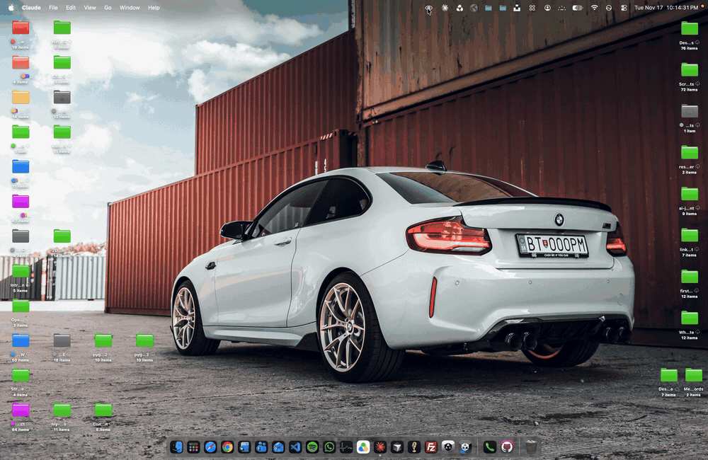

# DesktopToggle

A tiny macOS menu bar app that hides and shows all your Desktop icons with one click.



- **Click the eye icon** in the menu bar to hide your Desktop icons. Click again to bring them back.
- **Press `Ctrl + Option + D`** from anywhere to do the same.
- **Double-click the empty Desktop** while icons are hidden to bring them back.
- **Right-click the eye** for a menu with Quit. Quitting always brings your icons back.

Hiding and showing is instant, and Finder is never restarted.

Your files aren't moved or deleted, only hidden, and they come back in the same arrangement.

Works on macOS 13 or later, on both Apple Silicon and Intel Macs.

## Download

1. Download `DesktopToggle-x.y.z.zip` from the [latest release](https://github.com/byteforgeAP/DesktopToggle/releases/latest).
2. Unzip it and move `DesktopToggle.app` to your Applications folder.
3. The app isn't notarized by Apple, so macOS blocks it the first time. Open it once, close the warning, then go to **System Settings → Privacy & Security**, scroll down and click **Open Anyway** next to DesktopToggle. You only need to do this once. If you'd rather not, build it from source below.

To start it at login, add it in **System Settings → General → Login Items**.

## Install from source

Needs the Xcode Command Line Tools (`xcode-select --install`).

```bash
git clone https://github.com/byteforgeAP/DesktopToggle.git
cd DesktopToggle
./install.sh
```

This builds the app, copies it to `~/Applications/DesktopToggle.app` and adds a login item, so it starts automatically every time you log in.

## Uninstall

```bash
./uninstall.sh
```

This removes the app and its login item, and makes your Desktop icons visible again.

## Build only

```bash
./build.sh
```

The app is written to `build/DesktopToggle.app` as a universal binary. To make a release zip, run `./release.sh`.

## How it works

DesktopToggle covers your Desktop icons with a copy of your wallpaper: one borderless window per screen, sitting just above the icons and below every app window. Showing the icons just removes that window, so both directions are instant. The cover follows you across Spaces, uses the same fill, fit or stretch setting as your Desktop, and updates when you change screens or wallpapers.

If the wallpaper can't be read (for example an animated or Aerial wallpaper), DesktopToggle falls back to Finder's hidden `CreateDesktop` setting:

```bash
defaults write com.apple.finder CreateDesktop -bool false   # hide
defaults write com.apple.finder CreateDesktop -bool true    # show
killall Finder
```

This fallback takes about a second while Finder restarts.

If your wallpaper is managed by another app (like Unsplash Wallpapers), macOS keeps the image inside that app's private folder and blocks DesktopToggle from reading it, so the slower fallback is used. The right-click menu tells you when this happens. For instant mode, pick a wallpaper from **System Settings → Wallpaper** or from a photo in your own folders.

## Privacy

DesktopToggle needs no permissions. It makes no network connections and collects nothing. The only things it does are read your wallpaper image, change Finder's `CreateDesktop` setting and restart Finder (fallback only). The shortcut is registered with macOS directly, so the app never sees any other keys you press.

The global shortcut uses Carbon's `RegisterEventHotKey`, so the app doesn't need Accessibility permission.

If another app already uses `Ctrl + Option + D`, the shortcut won't work, but clicking the eye still does. The right-click menu tells you when this happens.

## License

[MIT](LICENSE) © 2026 Ayush Patel

## Project layout

```
Sources/main.swift                                   The whole app
Resources/Info.plist                                 App bundle info (menu bar only, no Dock icon)
Resources/io.github.byteforgeap.DesktopToggle.plist  Login item template
build.sh                                             Builds build/DesktopToggle.app (universal)
install.sh                                           Builds, installs and starts at login
uninstall.sh                                         Removes everything and shows icons again
release.sh                                           Builds a zip for GitHub Releases
assets/demo.gif                                      Demo shown above
LICENSE                                              MIT License
```
